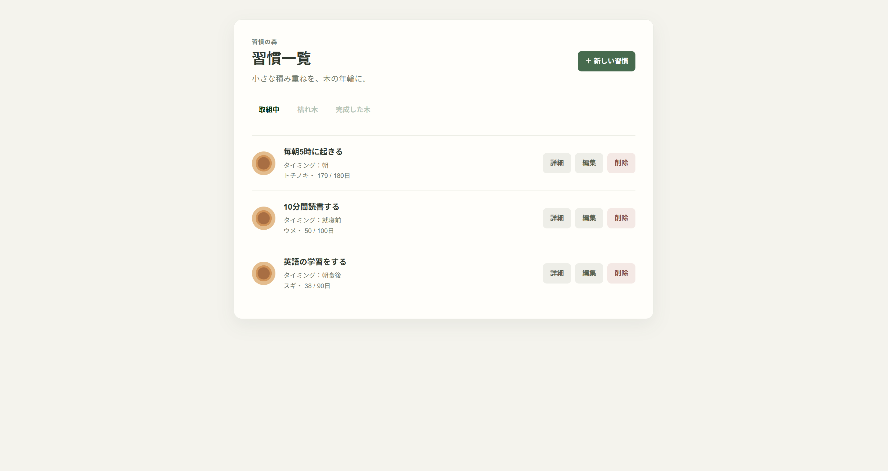
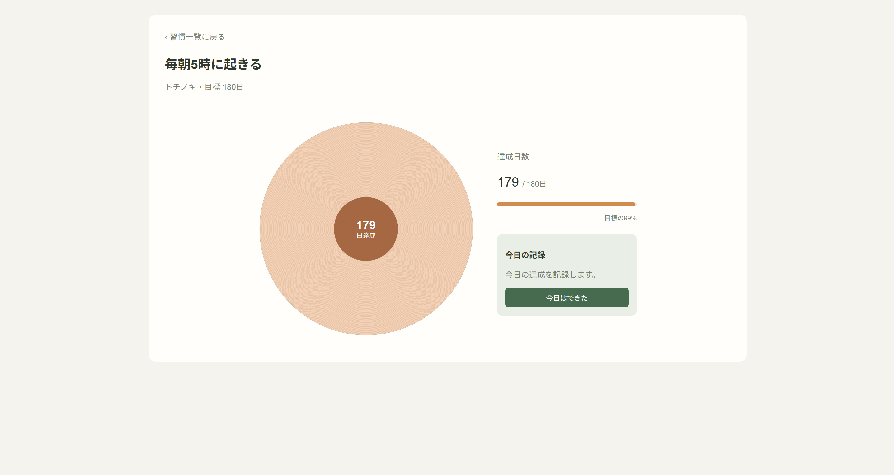
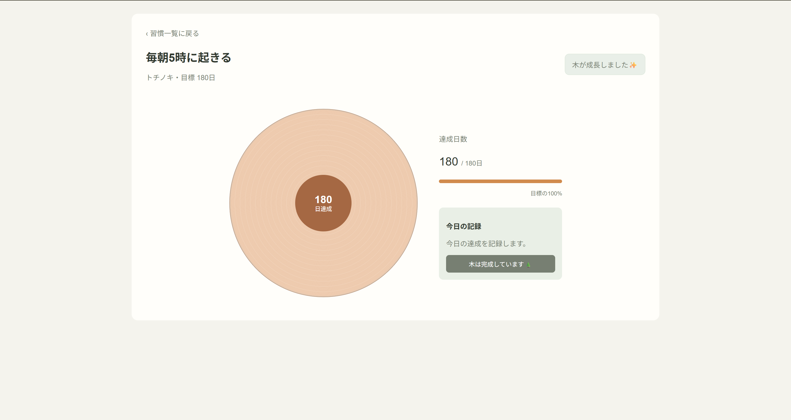
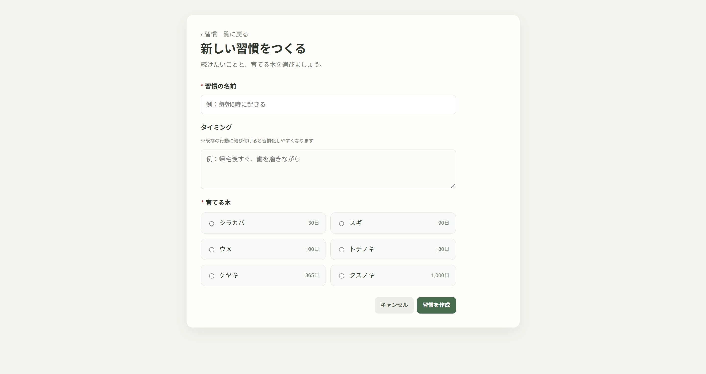
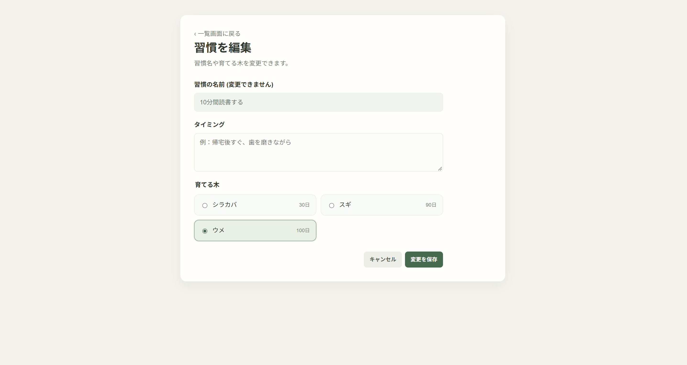

# 目次
- [概要](#概要)
- [デモ・スクリーンショット](#デモスクリーンショット)
- [使用技術](#使用技術)
- [機能・特徴](#機能特徴)
- [利用手順](#利用手順)
- [環境構築手順](#環境構築手順)
- [初期データ](#初期データ)
- [学習メモ](#学習メモ)
- [作成者](#作成者)

## 概要
### プロジェクト名：習慣の森
習慣の継続日数を木の年輪の増加により視覚的に把握できる習慣トラッカーです。

習慣化できた行動を見返すことができ、新たな行動の習慣化をサポートするアプリが欲しいという思いから作成しました。
より習慣化しやすくするために「既存の行動に繋げる」ことができるよう導線をサポートしました。

詳細設計は[HabitTracker/docs/詳細設計.md]を参照してください。

## デモ・スクリーンショット
### スクリーンショット






### デモ動画


## 使用技術
- PHP8.5.12
- Laravel 10
- MySQL
- React
- JavaScript
- HTML
- CSS
- Docker(Laravel sail)

## 機能・特徴
- 🖊 習慣化したい行動の新規作成・編集・削除
- 🌲 継続日数 = 木の年輪の数

## 利用手順
- 一覧画面には初期データが保存されています。不要であれば削除してください。（削除ボタンから削除できます）

### 行動の新規作成手順
- 新規作成ボタン（＋　新しい習慣）を押すと、作成画面へ推移します。
- 作成画面で「習慣化したい行動」、「いつ行うか（任意）」、「木の種類」を入力してください。赤色の*マークがついている欄は必須欄です。
※エラーが発生した場合はエラー文に従って内容を修正してください。

### 行動を実行した際の記録手順
- 該当の行動の詳細ボタンを押すと詳細画面に推移します。該当の行動を実行した際はこの画面に実装されている実行ボタンを押してください。
- 誤ってボタンを押してしまった場合、もう一度押すと取り消すことができます。24時までならば何度でも実行済み・取り消しを変更することができます。

### 継続が途切れてしまった場合
- 1日スキップしてしまうと前日の木の年輪の色が灰色に変化します。この状態で実行ボタンを押すと「継続している」と判断され引き続き年輪を育てることができます。（スキップした日の年輪の色は灰色のままです）つまり、1日スキップしてしまっても継続記録は途切れません。
- 2日以上スキップすると木全体が灰色に変化し、枯れてしまいます。この状態で実行ボタンを押すことはできません。
- 木を枯らしてしまった場合、再度やり直すことができます。育てなおすボタンを押して再度習慣化に挑戦してください。

### 行動の編集
- 編集ボタンを押すと編集画面に推移します。習慣化したい行動を変更することはできません。木の種類や行動タイミングを変更することはできます。
- 木の種類は現在選択している木の目標日数より日数が多いものしか選択できません。つまり、目標日数を延長することしかできません。

### 行動の削除
- 削除ボタンを押すと習慣化したい行動を削除することができます。一度削除すると取り消すことはできません。

# 環境構築手順

## 前提条件

- Git
- Docker Desktop
- Docker Compose

### リポジトリをクローン
```bash
git clone https://github.com/nara773work/HabitTracker
```

### ディレクトリに移動
```bash
cd ディレクトリ名
```

### 環境変数を設定
```bash
cp .env.example .env
```

### コンテナの起動
```bash
./vendor/bin/sail up -d
```

### PHPの依存関係のインストール
```bash
./vendor/bin/sail composer install
```

### アプリケーションキーを作成
```bash
./vendor/bin/sail artisan key:generate
```

### JavaScriptの依存関係をインストール
```bash
./vendor/bin/sail npm install
```

### DB作成・初期データ投入 
```bash
sail artisan migrate:fresh --seed
```
※初期データが不要な場合は以下のコマンドを実行してください

```bash
sail artisan migrate:fresh 
```

### Viteを起動
```bash
./vendor/bin/sail npm run dev
```

### コードの整列
```bash
sail pint
```

### URL
以下のURLをブラウザで開き、ページが正常に表示されたら成功です。
http://localhost/habits

### コンテナの停止
```bash
./vendor/bin/sail down
```

## 初期データ
HabitTracker/database/seederに実装されています。
木の種類はここから増やしてください。

- 木の種類
| 木の種類 | 目標日数(日) |
| --- | --- | --- |
| シラカバ | 30 |
| スギ | 90 |
| ウメ | 100 |
| トチノキ | 180 | 
| ケヤキ | 365 | 
| クスノキ | 1000 | 


- 習慣
 習慣名 | ステータス | 木の種類 | 積み上げ日数(日) |
| --- | --- | --- | --- |
| 5時に起きる | ongoing | トチノキ | 179 |
| 10分間読書する | ongoing | ウメ　| 50  |
| 毎日ストレッチする | withered | ケヤキ | 5 |
| 英語の学習をする | ongoing | スギ | 38 |
| 1日8000歩歩く | completed | シラカバ | 30 |

## 学習メモ

### AIエージェント（codex）の活用について
#### 活用場面
- UI設計（HTML、CSSを実装してもらった）
- 詳細設計の評価
- テスト項目の評価
- 検索エンジンとして（○○の実装方法など）

#### 活用して得た気づきメモ
- 詳細設計の評価 → UI実装(してもらう)という手順にすると、どのようなアプリを作成しているのか伝わっているため思い通りのUIが仕上がった。

- 簡単なHTMLファイルでも骨格が出来上がっていて、あとから編集するだけで良くなると効率が爆上がりする。（そのためにHTMLを理解することは必須だった）

- 自分でコードを見直し、リファクタリングなどを行う場面があったのですべてcodex任せでは無理そうだった。ある程度の実装は助けてもらって、「見やすいコードにする」という仕上げには人の手が必要。（そのためにコードの理解必須）

- 今回は権限を与えずにほぼコピペでコードを実装したが、これ実際に作業させたらもっと複雑なアプリも簡単に作れる！！

- 設計でいかに詰めるかがめちゃくちゃ大事だった。後から仕様を考えたり変更するとDBの処理の流れがわけわからんことになるので、できる限り仕様は変更したくないし追加で考えたくない！！

- アプリを実際に使うのは人なので設計は人がやるべきだろうなーと思った。設計するためにコードを知る必要があるのでやっぱりコードが書けないとAIは使いこなせない気がした。

### 工夫したこと
- コントローラーのロジックを薄く保つこと。（showがロジックモリモリになりそうだったのでactionに分けた）

- DB設計や初期データ、処理の流れを詳細設計で細かく考えてたのでスムーズに実装できたこと。（詳細設計割とよかったかも？）

- 初期データでできる限り条件を散らしたこと

### 学習したこと
- Carbon::parse()：日付を文字列からオブジェクトに変換できる。日を進めたり、比較するメソッドが使えるようになる。

- フロントエンド⇔バックエンド間のデータ受け渡し方法：{{変数名}}で変数をフロントに渡せる。なんとなく知ってたけど実際に実装したのは初めてだった。

### 今後の改善予定
- 

## 作成者
[奈良那々美]-初心者エンジニア
作成期間:2026.11.21~11.27